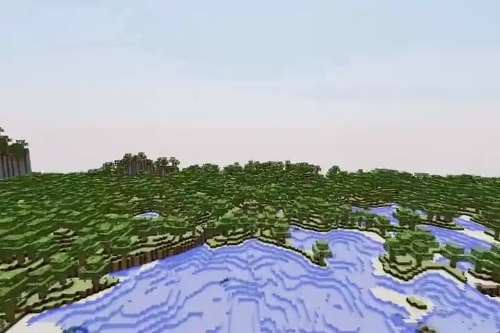

# Minecraft Clone

[](https://github.com/BenEklundCS/Minecraft/actions/workflows/test-and-build.yml)
[](https://openjdk.org/projects/jdk/21/)
[](https://www.opengl.org/)
[](https://gradle.org/)

A voxel sandbox written from scratch in **Java 21** on **LWJGL** (OpenGL 3.3 core, GLFW, OpenAL)
and **JOML**. It runs as a **client/server game**: an authoritative server owns the world and
streams it to clients over TCP, and clients predict their own movement and reconcile against the
server. Singleplayer is the same server with one player connected.

<p align="center">
  <a href="media/flying-demo.mp4">
    
  </a>
  <br>
  <sub>Creative flight over streamed terrain. Click for the full 66-second flyover.</sub>
</p>

> **Not an official Minecraft product.** This is an independent, non-commercial project written
> from scratch as a learning exercise in graphics, engine and network programming. It is not
> approved by, endorsed by, or associated with Mojang Studios or Microsoft, and it shares no code
> or assets with Minecraft. "Minecraft" is a trademark of Mojang Studios.

---

## Highlights

### Networking

- **Authoritative server.** The server generates, stores and simulates the world on a 20 Hz tick
  thread. Clients send intent (`PlayerInput`, `BlockEdit`) and the server decides what happened.
- **Client-side prediction and reconciliation.** The client steps its own movement immediately,
  keeps unacknowledged inputs, then snaps to the server's state at the acked tick and replays the
  rest, so movement feels local even with latency.
- **Chunk streaming per player.** Each session tracks which chunks its player may hold and streams
  `ChunkData` / `ChunkUnload` as they move. Block edits fan out to every client as `BlockChanged`.
- **One protocol, two transports.** Packets are a sealed hierarchy of records. Host mode joins the
  local client through an in-JVM link that passes them by reference; remote clients get the same
  packets over a socket as length-prefixed frames, encoded by a `PacketCodec` that validates
  every read and rejects mismatched protocol versions at join.
- **Testable latency.** A `DelayedServerLink` injects delay for unit-testing prediction without a
  network.

### Engine

- **Infinite streaming world.** Generation and meshing run on worker pools; the main thread uploads
  finished meshes to the GPU under a per-frame budget, so terrain streams in without hitches.
- **Procedural generation.** OpenSimplex2 noise, composable biome and terrain specs, tree placement.
- **Build and break.** DDA raycast targeting, a 9-slot hotbar, and edits that persist across
  restarts.
- **Rendering.** Texture atlas from a JSON resource pack, frustum culling, a separate transparent
  pass for water, ambient occlusion, distance fog, sky lighting, and shader hot reload.
- **Physics.** Swept AABB collision, gravity, ground detection, and creative flight.
- **Audio.** OpenAL playback with OGG decoding through STB.

**Not built yet:** rendering other players, a dedicated headless server launch, items, crafting,
mobs and health.

---

## Getting started

Requires [Java 21](https://www.azul.com/downloads/) (Azul Zulu recommended). The Gradle wrapper is
included.

```bash
git clone https://github.com/BenEklundCS/Minecraft.git
cd Minecraft
./gradlew run
```

### Multiplayer

`run` with no arguments **hosts**: it starts a server, joins it locally, and listens on port
`25565` for other players. To **join** someone else's game:

```bash
./gradlew run --args="--join 192.168.1.20"          # default port 25565
./gradlew run --args="--join example.com:25570"
```

### Controls

| Key | Action |
|-----|--------|
| `WASD` | Move |
| `Mouse` | Look |
| `Left Click` / `Right Click` | Break / place block |
| `Scroll Wheel`, `1`-`9` | Select hotbar slot |
| `Space` | Jump |
| `Double-tap Space` | Toggle creative flight |
| `Left Shift` | Sneak, or descend while flying |
| `F5` | Reload shaders |
| `X` / `Esc` | Quit |

---

## Architecture

Four Gradle modules. The arrows are `launcher -> client -> core` and `launcher -> server -> core`;
client and server cannot see each other, so the split is a compile error rather than a convention.

```
core/      shared domain and protocol; no GL, GLFW or window on the classpath
  block/           Block types, BlockDef, BlockRegistry
  world/           Chunk, World, ChunkState, lighting
  player/          Physics, PlayerState, PlayerMovement, Hotbar
  util/            Raycast (DDA), AABB, Direction, OpenSimplex2
  net/             IPacket, PacketCodec, PlayerPrediction, InJvmLink, Socket*Link

server/    headless: owns the authoritative world, never meshes
  world/gen/       World generation (ChunkPos + seed -> Chunk)
  infra/           ServerChunkManager, SaveFile, ChunkStore, PlayerStore
  net/             GameServer, PlayerSession, SocketAcceptor, IChunkStreamer
  container/       ServerContainer: composition root and tick thread

client/    everything that touches a GPU, window, keyboard or speaker
  renderer/        ChunkMesher, Camera, ShaderProgram, TextureAtlas
  platform/        GLFW window and input, OpenGL objects, OpenAL, STB, resource packs
  infra/           ClientChunkManager (replica + meshing pool), RenderWorld
  container/       ClientContainer: client composition root

launcher/  Main, LaunchArgs, Launcher: Host runs both halves in one process, Join runs a client
```

Three rules shape the code:

1. **Dependencies point one way.** The domain knows nothing about OpenGL, GLFW or threads.
   Platform adapters own the hardware; containers wire everything together.
2. **Only the main thread calls OpenGL.** Worker pools produce plain arrays; the main thread turns
   them into GPU buffers.
3. **No singletons.** Every dependency arrives through a constructor, and `ClientContainer` and
   `ServerContainer` are the only places that construct platform, renderer, world or infrastructure
   types.

The load-bearing details are documented where they are enforced: the chunk state machine and its
thread-safety rules in `ChunkState`, `ServerChunkManager` and `ClientChunkManager`, and the
startup ordering contract in `ClientContainer`.

---

## Development

```bash
./gradlew build                 # format check, checkstyle, compile, unit tests
./gradlew test                  # unit tests only
./gradlew integrationTest       # slow suite that spins up real chunk managers
./gradlew spotlessApply         # format (palantir-java-format)
```

CI runs `build` plus a short headless smoke launch under Xvfb, so a startup crash fails the build.
Integration tests stay out of `build` because they take minutes; run them when touching the chunk
pipeline. The first `build` points `core.hooksPath` at `.githooks`, whose pre-commit hook formats
staged Java.

### Configuration

Launch settings (seed, render distance, FOV, window size, resource pack, spawn) live in the
`ClientConfig` and `ServerConfig` defaults. Optional per-machine overrides go in a gitignored
`local.properties` at the repo root; see `local.properties.example`.

### Logging

Logs are split by subsystem (`chunk`, `world`, `render`, `gpu`, `input`, `player`, `io`, `audio`,
`perf`), each filterable at runtime. Logback rescans its config every five seconds.

```bash
./gradlew run -Dlog.all=DEBUG
./gradlew run -Dlog.chunk=TRACE                  # only chunk streaming, the rest at INFO
./gradlew run -Dlog.all=DEBUG -Dlog.perf=OFF
```

### Saves

The server saves worlds to `saves/<seed>/`: chunks as `<x>_<z>.bin`, players as `level.dat`. Each
file is a 12-byte header (magic, format version, payload length) plus payload. Reads validate the
header and fall back to regenerating instead of crashing; writes go to a temp file and are moved
into place atomically.

---

## Credits and licensing

The engine code is MIT licensed; see [LICENSE](LICENSE). Bundled assets are third-party work under
their own terms, with full attribution in
[`client/src/main/resources/CREDITS.txt`](client/src/main/resources/CREDITS.txt):

| Asset | Source | License |
|-------|--------|---------|
| Textures (`packs/faithful/`) | [Faithful](https://faithfulpack.net), via [Zormein's Faithful Clone](https://github.com/Zormein/Faithful-Clone) port for MineClone2/VoxeLibre | CC BY-SA 4.0 |
| Sounds (`sounds/`) | [Minetest Game / Luanti](https://github.com/luanti-org/minetest_game) | CC BY-SA 3.0 |
| Music (`music/public/`) | Kai Engel | CC0 |

The [Faithful license](https://faithfulpack.net/license) permits use in non-Minecraft projects with
credit and a visible link back. If you fork this and ship anything from it, keep that attribution
intact.
